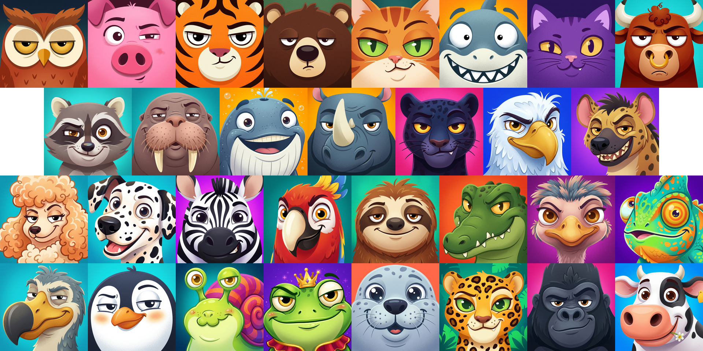
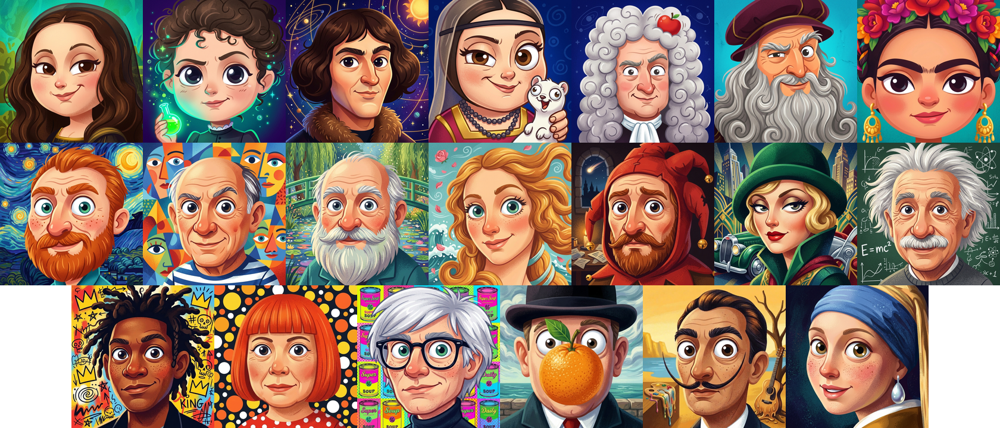
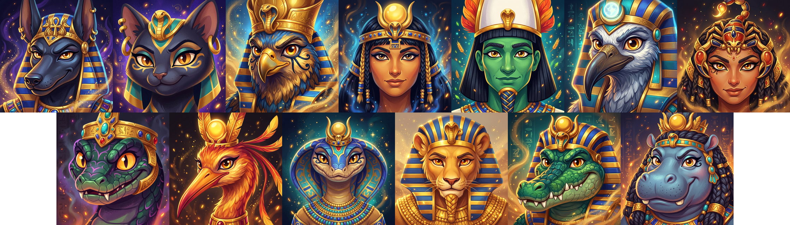
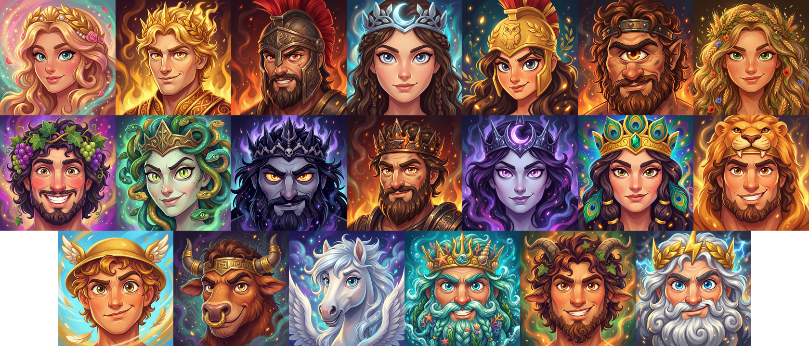
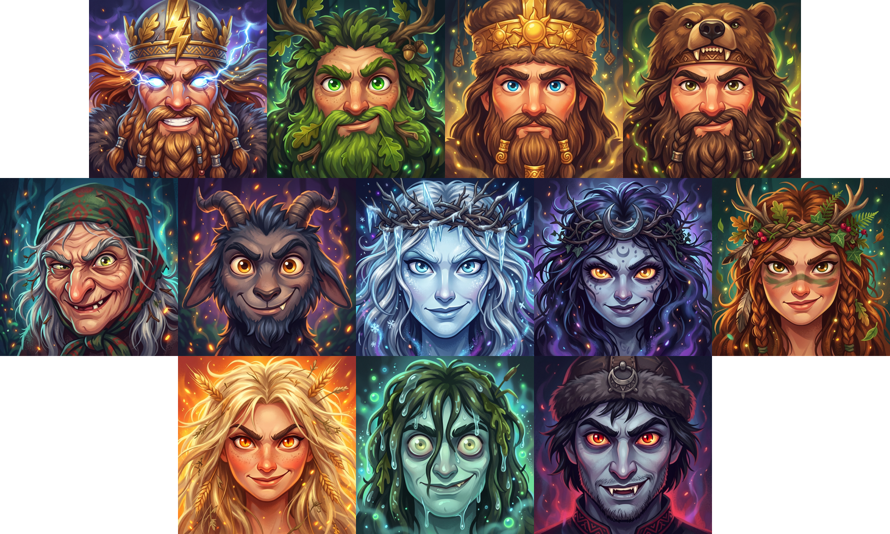

# FLEX Avatars

Ready-to-use illustrated profile avatars for apps, onboarding flows, and avatar pickers.
Choose from 96 illustrations across five collections. Each avatar has a small AVIF preview and a larger original, so a picker can show thumbnails and load the full image when someone selects one.

[Browse the gallery](https://janczakb.github.io/flex-avatars/)

| Collection | ID | Avatars |
| --- | --- | ---: |
| Animals | `animals` | 31 |
| Art | `art` | 20 |
| Egypt | `egypt` | 13 |
| Greek mythology | `greek` | 20 |
| Slavic mythology | `slavic` | 12 |

## Explore the collections

<details open>
  <summary><strong>Animals</strong> · 31 avatars</summary>
  <br>
  
</details>

<details>
  <summary><strong>Art</strong> · 20 avatars</summary>
  <br>
  
</details>

<details>
  <summary><strong>Egypt</strong> · 13 avatars</summary>
  <br>
  
</details>

<details>
  <summary><strong>Greek mythology</strong> · 20 avatars</summary>
  <br>
  
</details>

<details>
  <summary><strong>Slavic mythology</strong> · 12 avatars</summary>
  <br>
  
</details>

## Use a single avatar

The versioned URLs work directly in HTML. Use a preview in lists and the larger file for a profile or when saving a user's choice.

```html

```

## Browse or assign avatars in JavaScript

Use the browser module on an HTTPS page or localhost. It fetches each collection's JSON only when requested. It returns preview and original URLs for you to render.

```js
import { createCatalog } from 'https://cdn.jsdelivr.net/gh/janczakb/flex-avatars@v0.1.1/src/catalog.js'

const catalog = createCatalog()
const collections = await catalog.collections()
const animals = await catalog.avatars('animals')
const bear = await catalog.find('animals/bear')
const defaultAvatar = await catalog.pick('user-42', 'animals')

document.querySelector('#avatar').src = defaultAvatar.previewUrl
```

Store the returned ID, such as `animals/bear`, on the user profile. Assignment is deterministic within a catalogue version. Saving the ID keeps existing users' avatars stable when collections grow. Use the application's own user ID as the seed. The browser hashes it locally.

## Use the catalogue in PHP

Install from the GitHub tag with Composer's VCS repository support, or clone the repository and load it from a Composer path repository during development. Use PHP 8.3 or later.

```bash
composer config repositories.flex-avatars vcs https://github.com/janczakb/flex-avatars.git
composer require useflex/avatars:^0.1 --prefer-dist
```

```php
use UseFlex\Avatars\Catalog;

$catalog = new Catalog();
$avatar = $catalog->find('animals/bear');
$default = $catalog->pick((string) $user->id, 'animals');
$original = Catalog::assetsPath().'/'.$avatar['image'];
```

The Composer distribution contains the catalogue and AVIF images. The WebP collages, demo and tests are part of the Git checkout.

Both APIs return an empty list for unknown collections and `null` for unknown avatar IDs. PHP returns paths relative to `Catalog::assetsPath()`. Serve only the `assets/` directory from your public web root to self-host the catalogue. Pass that directory's public URL to `createCatalog()` to make the browser module use it.

## FLEX Fields

FLEX Fields provides the Filament upload field, picker, cropping, and storage workflow. Its `avatarGallery()` field configuration already offers these five collections. See the [FLEX Fields avatar gallery guide](https://flex-fields.bjanczak.com/docs/file-upload-avatar-gallery).

## License

The code and catalogue metadata are [MIT](LICENSE). The [illustrations](assets/LICENSE.md) are CC BY 4.0 and can be used commercially with attribution.

## Local checks

```bash
composer validate --strict
php tests/catalog.php
npm test
php -S 127.0.0.1:8080
```
